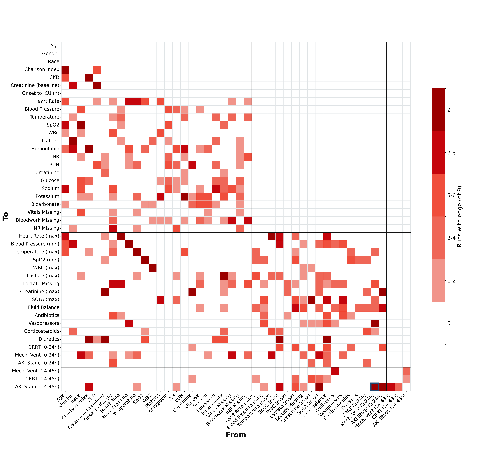

# Sepsis-3 Causal Discovery Ensemble

## Abstract

Early ICU interventions in sepsis, such as mechanical ventilation, may
contribute to acute kidney injury (AKI). These effects are hard to study in
randomized trials, and conventional observational analyses require the causal
structure to be specified in advance. We applied constraint-based causal
discovery to 8,958 adult sepsis ICU admissions from MIMIC-IV with a linked
emergency department stay. The exposure was mechanical ventilation in the first
24h after sepsis onset; the outcome was the maximum KDIGO AKI stage 24-48h
after onset. Because each discovery algorithm rests on untestable assumptions
about causal sufficiency, functional form and missing-data mechanisms, we ran
an ensemble of 12 configurations spanning two algorithms (PC, FCI), three
conditional independence tests (Fisher-Z, missing-value Fisher-Z, RCIT), three
missing-data strategies (test-wise deletion, median, KNN) and a sensitivity
variable set. All configurations shared temporal background knowledge. Edges
were judged by how consistently they appeared. Early ventilation was adjacent
to, and oriented into, 24-48h AKI in all 12 runs. Maximum 0-24h SOFA score was
the most consistent shared neighbour of exposure and outcome, making it the
main candidate confounder that any effect estimate must adjust for. The
results are hypotheses for targeted causal-effect estimation, not effect
estimates themselves.

## 1. Introduction

Randomized trials are the standard way to establish cause and effect, but for
many questions in sepsis care they are not an option. Withholding or assigning
ventilation, fluids or vasopressors at random in critically ill patients is
often unethical. Where it is ethical, a trial is slow and expensive, and it
usually tests one intervention at a time in a narrow population. In practice,
most of what we know about how early ICU care relates to downstream organ
injury comes from observational data.

Causal discovery uses that observational data to learn which variables
plausibly cause which. It uses conditional independence tests plus background
knowledge, here the time order of events, to recover a graph of candidate
causal relationships. It doesn't replace a trial. It narrows down which
relationships are worth testing and points out the confounders and mediators
any downstream effect estimate has to account for.

Each discovery run rests on assumptions that can't be fully checked against
the data:

- **Faithfulness and the causal Markov condition.** The independencies seen in
  the data match the true graph.
- **Causal sufficiency (PC only).** There are no unmeasured common causes. FCI
  relaxes this, at the cost of less specific output.
- **The CI test is appropriate.** Fisher-Z assumes linear-Gaussian
  relationships. RCIT is nonparametric but needs subsampling to stay tractable.
- **Missing data is handled correctly.** Test-wise deletion (`mv_fisherz`)
  assumes data are missing at random given the other variables. Imputation
  assumes the imputation model is right.

No single run's graph should be trusted on its own. We therefore run the same
background knowledge across many combinations of algorithm, CI test,
imputation strategy and variable set, and judge edges by how consistently they
appear. The goal is hypothesis generation, not estimation: an edge that holds
up across assumptions is a stronger candidate for a targeted causal-effect
analysis than one that shows up in a single configuration.

## 2. Methods

### 2.1 Pipeline

1. **Extract the cohort.** `sql/causal_discovery_features_ed.sql` is run by
   hand in BigQuery and saved as `cohort/cohort.csv`.
   `sql/cohort_attrition.sql` produces the attrition counts.
2. **Build features.** `python build_ed.py` adds the Python-side features
   (baseline labs, treatments, the AKI outcome) from local MIMIC-IV tables and
   writes `cohort/analysis_final.csv`.
3. **Make the datasets.** `python datasets.py` recodes the outcome, adds
   missingness indicators and writes the raw, median-imputed and KNN-imputed
   datasets to `data/`. KNN is the slow step.
4. **Run discovery.** `causal_discovery.py` runs one PC or FCI configuration
   and writes `<run_name>.pkl` (the graph and column names) and
   `<run_name>.png` to the current directory. These go in `results/graphs/`.
   For example:

   ```bash
   python causal_discovery.py --run_key pc_fisherz --run_name pc_fisherz_main_knn \
       --data_path data/main_knn.csv --alpha 0.01 --depth -1
   ```

5. **Summarize.** `python summarize_discovery_runs.py` reads every graph and
   writes edge stability, the exposure-outcome link and neighbourhood tables
   to `results/`. `python heatmap.py` draws `results/heatmap.png`.

MIMIC-IV is credentialed data. `cohort/` and `data/` are gitignored and must
never be committed.

### 2.2 Cohort

Starting from 32,899 Sepsis-3 ICU stays in MIMIC-IV 3.1, we kept stays with a
linked ED visit, ED arrival to ICU within 24h, no ESRD or chronic dialysis, and
no ventilation before sepsis onset, then took the first qualifying stay per
patient. This leaves 9,006 patients, and 8,958 after the outcome recode below.

### 2.3 Outcome

The outcome is `aki_24to48h_max_stage`, the maximum AKI stage in
onset+24h..onset+48h. 1,129 rows (12.5%) have no 24-48h creatinine.
`datasets.py` splits them:

- **died before onset+48h** -> stage 4. Judged against the full 48h bound, not
  one truncated by `icu_outtime`, so a patient discharged at 30h who dies at
  40h is counted here rather than falling through to the next case.
- **discharged alive with <= 6h of the window** -> stage 0. No realistic chance
  of a draw, so missing means no AKI.
- **everything else** -> dropped (48 rows). The patient was present and alive
  long enough that missing means not-measured, and asserting stage 0 would be
  a free pass.

Use `missingness_report.py --raw` to see rates before this step.

### 2.4 Temporal background knowledge

Background knowledge is a tier ordering defined once in `tiers.py`. Edges may
only run forward in tier; `age`, `gender`, `race` take no incoming edges.

| Tier | Contents |
| --- | --- |
| 0 | Baseline demographics, comorbidity, `onset_to_icu_hrs` |
| 1 | Pre-sepsis physiology (lookback ends **at** onset) |
| 2 | All 0-24h post-onset variables |
| 3 | 24-48h outcomes |
| 4 | 28-day mortality |

`onset_to_icu_hrs` governs tier-1
missingness: the vitals/SOFA source tables are `stay_id`-keyed and hold nothing
before `icu_intime`, and 86% of this cohort is already septic on arrival. Leave
it out and that structure becomes a latent common cause of every tier-1
indicator, which PC can only express as a spurious clique.

Tier 2 is flat. Treatments given in the first 24h and the physiology measured
over that window overlap in time, so no sub-ordering is defensible.

### 2.5 Missing data

Indicators are carried per mechanism, not per column. Membership and the
evidence for it are in `tiers.py`; regenerate with `indicator_grouping.py` and
`baseline_window_check.py`.

| Handling | Columns | Why |
| --- | --- | --- |
| `bloodwork_panel_missing` | 9 chemistry/heme analytes | Ordered as one panel; within-group r 0.71-0.99 |
| `vitals_panel_missing` | heart_rate, blood_pressure, spo2, temperature_c | Monitoring cadence, a different mechanism — only r~0.22 against bloodwork |
| `inr_missing` | inr (40.9%) | r=0.434 against the panel, so not the panel's mechanism |
| `lactate_0to24h_max_missing` | lactate_0to24h_max (14.2%) | ~7x the next tier-2 column |
| sensitivity only | lactate (78.6%), bilirubin (52.6%) | Ordering-driven, plausibly MNAR — dropped from main entirely |

The lactate/bilirubin split rests on the `onset_to_icu_hrs >= 72` subgroup,
where the window mechanism is removed and both stay above 70% while the panels
fall under 1%. Nine tier-2 columns carry <2% missingness with no indicator:
deliberate, since an indicator that flags 2 rows is near-constant and pushes
the Fisher-Z correlation matrix toward singularity.

### 2.6 Datasets

`datasets.py` writes six files. Imputation is fit per tier, using only that
tier's columns plus tier 0, so a later tier can't leak into an earlier one.

| File | Contents |
| --- | --- |
| `main_raw.csv` | Values only, NaNs preserved — for `mv_fisherz` |
| `main_simple.csv` | Median/mode imputed + indicators |
| `main_knn.csv` | KNN imputed + indicators |
| `sens_simple.csv` / `sens_knn.csv` | Adds lactate + bilirubin and their indicators |


### 2.7 Discovery ensemble

The final ensemble is 12 runs, 7 PC and 5 FCI, in `results/graphs/`. Nine
use the main cohort; three are sensitivity runs on the `sens_*` datasets,
which add the high-missingness lactate and bilirubin columns and their
indicators. Raw data pairs with `mv_fisherz` (test-wise deletion); imputed
data with Fisher-Z (linear) or RCIT (nonparametric). All runs use alpha 0.01;
PC runs at unlimited depth, FCI at depth 4.

| Run | Algorithm | Test | Data | n |
| --- | --- | --- | --- | --- |
| `pc_mv_main` | PC | mv_fisherz | `main_raw` | full |
| `pc_fisherz_main_simple` | PC | Fisher-Z | `main_simple` | full |
| `pc_fisherz_main_knn` | PC | Fisher-Z | `main_knn` | full |
| `pc_rcit_main_simple` | PC | RCIT | `main_simple` | 7,500 |
| `pc_rcit_main_knn` | PC | RCIT | `main_knn` | 7,500 |
| `fci_mv_main` | FCI | mv_fisherz | `main_raw` | 5,000 |
| `fci_fisherz_main_simple` | FCI | Fisher-Z | `main_simple` | 5,000 |
| `fci_fisherz_main_knn` | FCI | Fisher-Z | `main_knn` | 5,000 |
| `fci_rcit_main_simple` | FCI | RCIT | `main_simple` | 5,000 |
| `pc_fisherz_sens_simple` | PC | Fisher-Z | `sens_simple` | full |
| `pc_fisherz_sens_knn` | PC | Fisher-Z | `sens_knn` | full |
| `fci_fisherz_sens_simple` | FCI | Fisher-Z | `sens_simple` | 5,000 |

The last three rows are the sensitivity runs. "Full" is all 8,958 rows.

### 2.8 Aggregation

`summarize_discovery_runs.py` scores each variable pair by how many runs make
it adjacent, overall and within run families (PC vs FCI, linear vs
nonparametric, main vs sensitivity), and records the most common edge type.
Agreement scores below count adjacency across the 9 main-cohort runs; the
`mv_fisherz` runs have no indicator columns, so indicator edges are out of 7.

## 3. Results

Full tables are in `results/`: `run_summary.csv`, `key_link.csv`,
`edge_stability.csv`, `neighbourhood.csv` and `heatmap_table.csv`.



**Graph size.** Linear PC runs were the densest (117-192 edges, density
0.15-0.19). FCI runs at n=5,000 were sparser (97-150 edges), and RCIT runs the
sparsest (61-83 edges). RCIT left rare binary treatments such as CRRT and
corticosteroids isolated, consistent with low power on subsamples rather than
true independence.

**Exposure-outcome link.** `mechvent_0to24h` was adjacent to
`aki_24to48h_max_stage` in all 12 runs, oriented ventilation -> AKI every time
(tail at the exposure, arrowhead at the outcome). This held across both
algorithms, all three tests, every missing-data strategy and the sensitivity
variable set. The arrowhead's direction is partly fixed by the tier ordering,
so the robust finding is that the adjacency survives conditioning on every
covariate set the tests tried. In FCI, the tail mark additionally argues
against the link being explained only by a latent common cause.

**Candidate confounders.** `sofa_0to24h_max` was the only variable adjacent to
both exposure and outcome in most runs (8/9). SOFA -> AKI appeared in 9/9 runs,
always directed. Of the 8 runs where SOFA and ventilation were adjacent, the
edge was oriented SOFA -> ventilation in 4, the reverse in 1, and left
unoriented in 3. That pattern leans toward SOFA as a confounder rather than a
mediator. Charlson comorbidity index was
adjacent to the outcome in 8/9 runs but to ventilation in only 3/9.

**Other neighbours of the outcome.** Early AKI stage (9/9), 24-48h ventilation
(8/9), minimum 0-24h SpO2 (7/9) and maximum 0-24h lactate (6/9) were the most
consistent. Early AKI -> later AKI is the expected persistence of kidney
injury.

**Other neighbours of the exposure.** Vasopressors (9/9), maximum 0-24h
temperature (8/9), the vitals-panel missingness indicator (7/7) and race (7/9)
were adjacent to early ventilation in most runs. Fluid balance was adjacent in
6/9.

**Sanity checks.** Many of the most stable edges link the same measurement
across windows, such as baseline -> 0-24h blood pressure, heart rate, WBC and
creatinine (9/9 each), or are clinically expected, such as CKD -> baseline
creatinine and age -> Charlson index (9/9). Their stability supports the tier
encoding and the per-tier imputation.

**Interpretation.** The ensemble supports early mechanical ventilation as a
candidate cause of AKI at 24-48h. The main open question is how much of this
link runs through illness severity, captured here by SOFA, which any
effect-estimation study must adjust for. Other stable edges, such as
race -> baseline SpO2 (9/9) and race -> ventilation (7/9), are also worth
investigating, but these are adjacency patterns under shared assumptions, not
estimated effects.

**Next steps.** The next step is to estimate the ventilation -> AKI effect
with a target trial emulation in eICU, an independent multi-center ICU
database. Early ventilation versus no early ventilation is the emulated
intervention, and the adjustment set is taken from the ensemble's stable
neighbours: SOFA, Charlson index and the pre-sepsis physiology. Using a
separate database also tests whether the link holds outside a single center.
